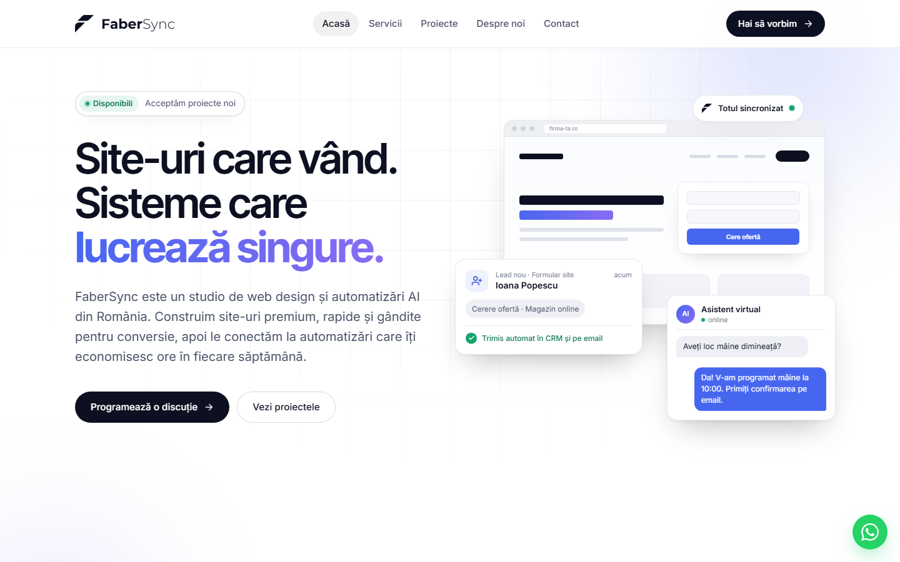

<div align="center">

# FaberSync

**Studio de web design & automatizări AI din România**

[fabersync.com](https://fabersync.com) · [contact@fabersync.com](mailto:contact@fabersync.com) · [WhatsApp](https://wa.me/40774584728)

<br>



</div>

<br>

## Despre proiect

Acesta este site-ul de prezentare FaberSync: un site static, rapid și complet responsive, construit de la zero, fără framework-uri și fără dependențe. Folosește doar HTML, CSS și JavaScript.

- **Design premium**, cu temă deschisă și accente închise, plus tipografie modernă (Inter, Inter Tight și Montserrat pentru logo)
- **5 pagini separate**: Acasă, Servicii, Proiecte, Despre noi, Contact
- **Animații discrete**: elementele apar treptat la derulare, iar prima secțiune are o ilustrație animată (lead-uri și asistent AI). Pentru utilizatorii care au cerut mai puțină mișcare în setări, animațiile sunt oprite (`prefers-reduced-motion`).
- **Portofoliu cu filtre** pe categorii de proiecte
- **Formular de contact** pregătit pentru automatizare prin webhook (Make, n8n, Zapier)
- **Buton WhatsApp** plutitor, pe toate paginile
- **SEO de bază**: titluri, meta descrieri și structură corectă a titlurilor pe fiecare pagină

## Structura

```
fabersync-site/
├── index.html          # Acasă
├── servicii.html       # Servicii și pachete
├── proiecte.html       # Portofoliu cu filtre
├── despre.html         # Povestea, echipa, valori
├── contact.html        # Date de contact, formular, întrebări frecvente
├── assets/
│   ├── css/styles.css  # Toate stilurile (variabile de culoare în :root)
│   ├── js/main.js      # Meniu, animații, filtre, formular
│   └── img/            # Logo și favicon (SVG)
└── docs/
    └── screenshot.png  # Captura din README
```

## Rulare locală

Site-ul nu are nevoie de instalare sau compilare. Deschide `index.html` direct în browser sau pornește un server local:

```bash
python -m http.server 5510
```

Apoi deschide [http://localhost:5510](http://localhost:5510).

## Personalizare

| Ce vrei să schimbi | Unde |
| --- | --- |
| Culori, fonturi, spațieri | variabilele din `:root`, la începutul `assets/css/styles.css` |
| Texte | direct în fișierele `.html` |
| Proiectele din portofoliu | `proiecte.html` (și cele 3 proiecte de pe `index.html`) |
| Trimiterea formularului către un webhook | constanta `FORM_WEBHOOK_URL` din `assets/js/main.js` |
| Datele de contact | header, footer și `contact.html` |

După modificarea fișierelor CSS sau JS, crește numărul de versiune din link-uri (de exemplu `styles.css?v=9` → `?v=10`), ca vizitatorii să primească imediat noua versiune.

## Publicare

Fiind un site static, poate fi publicat gratuit pe **GitHub Pages**, **Netlify**, **Vercel** sau **Cloudflare Pages**, cu domeniul `fabersync.com`.

---

<div align="center">

© FaberSync. Toate drepturile rezervate.<br>
Codul și designul sunt publice doar pentru prezentare; nu pot fi reutilizate fără acord.

</div>
